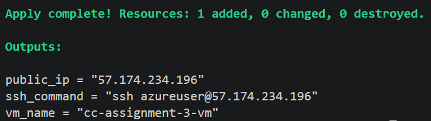
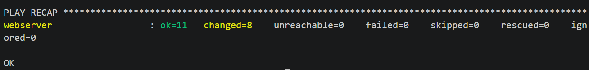
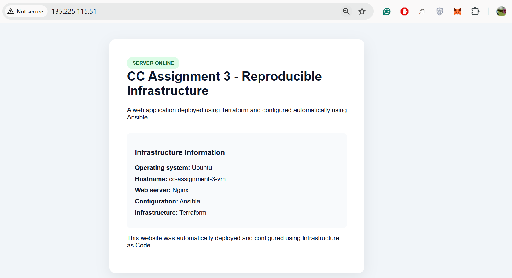
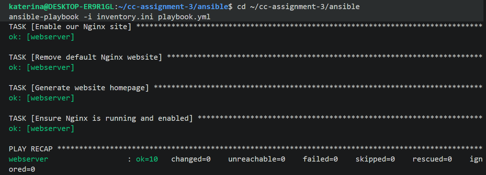
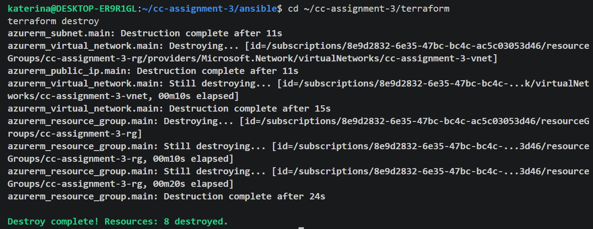

# Assignment 3 — Reproducible Infrastructure

**Name:** K. Montarroso · **Campus:** Madrid  
**Course:** Cloud Computing · **Repository:** `cc-assignment-3`  
**Cloud Provider:** Microsoft Azure (`swedencentral`) · **IaC & Config:** Terraform + Ansible · **OS & Server:** Ubuntu 22.04 LTS + Nginx

---

## 1. Project Overview
This project demonstrates reproducible infrastructure using **Terraform** and **Ansible** on **Microsoft Azure**. Terraform provisions the cloud infrastructure (resource group, virtual network, subnet, network security group, static public IP, network interface, and B-series Ubuntu Linux virtual machine with SSH key authentication). Ansible then connects over SSH to configure the operating system, install Nginx and Curl, generate the Nginx virtual host and static HTML page via Jinja2 templates, and ensure the web service is running and enabled.

The central reproducibility test proves that the entire environment can be destroyed (`terraform destroy`), rebuilt from code alone (`terraform apply` + `ansible-playbook`), verified over HTTP, and executed a second time with **`changed=0`**.

---

## 2. Architecture

```text
+-------------------------------------------------------------------+

|                     Local Control Node (WSL2)                     |
|   Terraform (Provisioning)  --->  Ansible (Configuration via SSH) |
+-------------------------------+-----------------------------------+
                                |
                                v
+-------------------------------------------------------------------+

|               Microsoft Azure (swedencentral)                     |
|  Resource Group: cc-assignment-3-rg                               |
|  +-------------------------------------------------------------+  |
|  | Virtual Network: cc-assignment-3-vnet (10.0.0.0/16)         |  |
|  | +---------------------------------------------------------+ |  |
|  | | Subnet: cc-assignment-3-subnet (10.0.1.0/24)            | |  |
|  | |                                                         | |  |
|  | |  [NSG: cc-assignment-3-nsg]                             | |  |
|  | |   - Allow TCP 22 (SSH)                                  | |  |
|  | |   - Allow TCP 80 (HTTP)                                 | |  |
|  | |         |                                               | |  |
|  | |         v                                               | |  |
|  | |  [Public IP (Standard)] ---> [NIC] ---> [Linux VM]      | |  |
|  | |                                        Standard_B2ts_v2 | |  |
|  | |                                        Ubuntu 22.04 LTS | |  |
|  | |                                        Nginx Web Server | |  |
|  | +---------------------------------------------------------+ |  |
|  +-------------------------------------------------------------+  |
+-------------------------------------------------------------------+
```

### Infrastructure Components & Network Security

| Component | Resource Name | Responsibility |
| :--- | :--- | :--- |
| **Resource Group** | `cc-assignment-3-rg` | Logical container for all project resources in `swedencentral` |
| **Virtual Network & Subnet** | `cc-assignment-3-vnet` / `cc-assignment-3-subnet` | Private `10.0.0.0/16` network with `10.0.1.0/24` VM subnet |
| **Network Security Group** | `cc-assignment-3-nsg` | Firewall allowing inbound **TCP 22 (SSH)** and **TCP 80 (HTTP)** only |
| **Public IP & NIC** | `cc-assignment-3-public-ip` / `cc-assignment-3-nic` | Static Standard IPv4 address attached to the VM interface |
| **Linux Virtual Machine** | `cc-assignment-3-vm` | `Standard_B2ts_v2` (Ubuntu 22.04 LTS) with Ed25519 SSH key auth (passwords disabled) and 30 GB `Standard_LRS` OS disk |

---

## 3. Repository Structure

```text
cc-assignment-3/
├── terraform/
│   ├── main.tf                     # Azure resource definitions (RG, VNet, Subnet, NSG, Public IP, NIC, VM)
│   ├── variables.tf                # Input variables with defaults (region, VM size, CIDRs, SSH key path)
│   ├── outputs.tf                  # Outputs exposing public_ip, vm_name, and ssh_command
│   ├── terraform.tfvars.example    # Example variable values (actual terraform.tfvars is gitignored)
│   └── .terraform.lock.hcl         # Provider dependency lock file for reproducibility
├── ansible/
│   ├── ansible.cfg                 # Ansible defaults (inventory path, host key checking, pipelining)
│   ├── inventory.ini.j2            # Jinja2 template generating inventory.ini from Terraform outputs
│   ├── render_inventory.yml        # Local playbook rendering inventory.ini
│   ├── playbook.yml                # Main idempotent playbook configuring Nginx and deploying the site
│   └── templates/
│       ├── nginx.conf.j2           # Jinja2 Nginx virtual host configuration (/ and /health)
│       └── index.html.j2           # Jinja2 web page rendered with Ansible variables and host facts
├── evidence/
│   ├── 01-terraform-apply.png      # Terraform provisioning output and public IP
│   ├── 02-ansible-first-run.png    # First Ansible run configuring the freshly built VM
│   ├── 03-working-website.png      # Live website accessible via HTTP after rebuild
│   ├── 04-ansible-second-run.png   # Second Ansible run proving idempotency (changed=0)
│   └── 05-terraform-destroy.png    # Terraform destroying all 8 Azure resources
├── .gitignore                      # Excludes .terraform/, *.tfstate, *.tfvars, private keys, inventory.ini
└── README.md
```

---

## 4. Prerequisites & Configuration
* **Tools**: Azure CLI (`az`), Terraform (`>= 1.5.0`), Ansible (`ansible-core`), OpenSSH client, and Git running in WSL2 Ubuntu.
* **Subscription & Region Verification**: Verified via `az policy assignment list`, `az vm list-sizes`, and `az vm list-usage` in **`swedencentral`** (`0 / 350` regional vCPUs used), selecting **`Standard_B2ts_v2`** (the available v2 B-series SKU without capacity restrictions in `swedencentral`).
* **Variables**: All deployment parameters (`location`, `vm_size`, `admin_username`, `ssh_public_key_path`, `admin_source_cidr`) are parameterized in `terraform/variables.tf`. Copy `terraform/terraform.tfvars.example` to `terraform/terraform.tfvars` (gitignored) and set your `admin_source_cidr` before running.

---

## 5. How to Run & Reproduce

### Step 1 — Authenticate with Azure
```bash
az login
az account set --subscription "<YOUR_SUBSCRIPTION_ID>"
export ARM_SUBSCRIPTION_ID=$(az account show --query id -o tsv)
```

### Step 2 — Provision Infrastructure with Terraform
```bash
cd terraform
terraform init
terraform fmt -recursive
terraform validate
terraform apply
```

### Step 3 — Generate Inventory & Configure the VM with Ansible
```bash
cd ../ansible
VM_IP=$(terraform -chdir=../terraform output -raw public_ip)
ssh-keygen -R "$VM_IP" 2>/dev/null || true
ssh-keyscan -H "$VM_IP" >> ~/.ssh/known_hosts 2>/dev/null

ansible-playbook -i localhost, render_inventory.yml -e "vm_public_ip=$VM_IP"
ansible-playbook -i inventory.ini playbook.yml
```

### Step 4 — Verify the Application & Idempotency
```bash
# Verify HTTP endpoints
curl http://$VM_IP/health   # Returns: OK
# Open http://<VM_IP> in a browser to view the rendered web page

# Run playbook a second time to verify idempotency (changed=0)
ansible-playbook -i inventory.ini playbook.yml
```

### Step 5 — Destroy Infrastructure
```bash
cd ../terraform
terraform destroy
```

---

## 6. Reproducibility Test Results

| Test Stage | Command | Outcome |
| :--- | :--- | :--- |
| **1. Initial Provisioning** | `terraform apply` | Created all 8 Azure resources cleanly |
| **2. Initial Configuration** | `ansible-playbook -i inventory.ini playbook.yml` | Installed Nginx, rendered templates, started service (`changed=8, failed=0`) |
| **3. Destruction** | `terraform destroy` | Destroyed all 8 Azure resources (`Resources: 8 destroyed`) |
| **4. Rebuild from Code** | `terraform apply` + `ansible-playbook` | Recreated identical VM and web server on a new public IP (`135.225.115.51`) |
| **5. Idempotency Check** | `ansible-playbook -i inventory.ini playbook.yml` (2nd run) | **`ok=11, changed=0, unreachable=0, failed=0`** |

---

## 7. Part C — Reasoning

### 7.1 Where Is the Line?
I used **Terraform** for tasks that create and manage cloud infrastructure resources, and **Ansible** for tasks that configure the operating system and software running inside the virtual machine.

Terraform provisioned the Azure resource group, virtual network, subnet, network security group, static public IP address, network interface, and Ubuntu Linux virtual machine. These resources define the cloud environment required to host the application. Ansible then connected over SSH to configure the operating system after provisioning: updating the APT cache, installing `nginx` and `curl`, creating `/var/www/cc-assignment-3`, rendering the Nginx site configuration and HTML page from Jinja2 templates, enabling the site, and ensuring the `nginx` service is started and enabled.

My guiding rule is that **Terraform owns the existence and cloud-level lifecycle of infrastructure resources, while Ansible owns the software state and application configuration inside the guest OS**.
One task that could have belonged to either tool is **firewall configuration**. Terraform can enforce network-level traffic rules via an Azure **Network Security Group (NSG)** before packets ever reach the VM, whereas Ansible could configure a host-level firewall inside Ubuntu such as **UFW** (`community.general.ufw`). I assigned this task to Terraform because the assignment requires an NSG and because perimeter network filtering belongs to cloud infrastructure rather than application software configuration.

### 7.2 Idempotency
My playbook was designed to be idempotent from the start, and its second consecutive run reported **`changed=0, failed=0`**.

I achieved this by using declarative Ansible modules rather than imperative shell commands:
* **`ansible.builtin.apt` (`state: present`, `cache_valid_time: 3600`)** verifies whether `nginx` and `curl` are already installed and skips reinstallation.
* **`ansible.builtin.file`** checks directory ownership/permissions (`state: directory`), symlink targets (`state: link`), and absence of the default site (`state: absent`), making changes only if drift occurs.
* **`ansible.builtin.template`** compares the SHA-1 checksum of the rendered Jinja2 output against the destination file on the VM and only overwrites the file (and triggers the `Reload Nginx` handler) when contents actually differ. Notice that `index.html.j2` avoids dynamic timestamps so the rendered output stays identical across runs.
* **`ansible.builtin.service` (`state: started`, `enabled: true`)** confirms Nginx is running and enabled at boot without unnecessarily restarting it.

The module that would most easily have broken idempotency is **`ansible.builtin.shell`** (or `command`). Unlike declarative modules, `shell:` executes blindly on every run and always reports `changed=true` unless guarded by custom `creates:` or `changed_when:` conditions—for example, running `shell: echo "..." >> /etc/nginx/sites-available/cc-assignment-3` would append duplicate configuration lines on every execution and break Nginx.

### 7.3 Terraform State
**Terraform state** (`terraform.tfstate`) is a JSON file that records the exact mapping between resource blocks in `.tf` configuration files and the real Azure resources created in the cloud, including Azure resource IDs, IP addresses, dependencies, and resource attributes.

The state file matters because Terraform compares your desired `.tf` configuration against `terraform.tfstate` (and refreshes live cloud attributes) to calculate minimal execution plans during `plan`, `apply`, and `destroy`. Without the state file, Terraform would not know which Azure resources it already owns—causing it to fail updates, leave orphaned resources behind during destroy, or attempt to create duplicate resources. Because state files can contain sensitive metadata in plain text, `terraform.tfstate` and `terraform.tfstate.backup` are strictly excluded from Git via `.gitignore`.

If **two people ran `terraform apply` at the same time from different machines** using local state files, both processes would read outdated snapshots lacking the other person's changes. They would race against the Azure API—causing conflicting updates, partial resource creation errors, corrupted state files, or one engineer inadvertently overwriting or deleting resources just created by the other. In a team environment, this is solved by storing state in a **shared remote backend** (such as Azure Blob Storage) with **state locking** enabled, which acquires an exclusive lease during `apply` so concurrent runs queue safely instead of colliding.

---

## 8. Evidence

* **1. Terraform Provisioning (`evidence/01-terraform-apply.png`)**  
  

* **2. First Ansible Configuration Run (`evidence/02-ansible-first-run.png`)**  
  

* **3. Working Website After Rebuild (`evidence/03-working-website.png`)**  
  

* **4. Second Ansible Run Showing `changed=0` (`evidence/04-ansible-second-run.png`)**  
  

* **5. Terraform Destruction (`evidence/05-terraform-destroy.png`)**  
  

---

## 9. Cleanup
After capturing all evidence, the entire Azure resource group (`cc-assignment-3-rg`) and all 8 managed resources were destroyed (`terraform destroy` / `az group delete`), and verified with `az group exists --name cc-assignment-3-rg` returning `false`.

---

## AI Use Disclosure
I acknowledge the use of OpenAI ChatGPT (https://chatgpt.com) and Google Gemini (https://google.com) to assist with this assignment. ChatGPT was used to generate the initial step-by-step setup guide, and Google Gemini was used to assist with troubleshooting WSL2, Azure SKU capacity selection, NSG SSH rules, executing the Terraform/Ansible reproducibility workflow, and formatting the documentation. The prompts used include requests for initial implementation instructions, resolving Azure `SkuNotAvailable` and SSH connectivity issues, verifying idempotency and cleanup, and organizing the `README.md` answers. All Terraform deployments, Ansible runs, rebuild tests, and screenshots were executed and verified directly in my own environment.